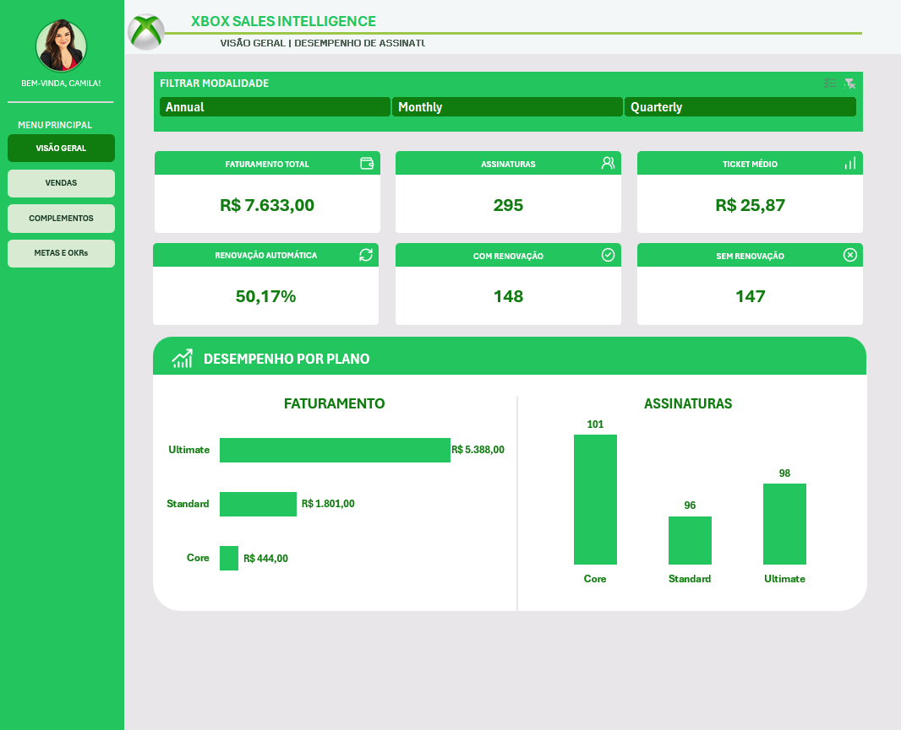
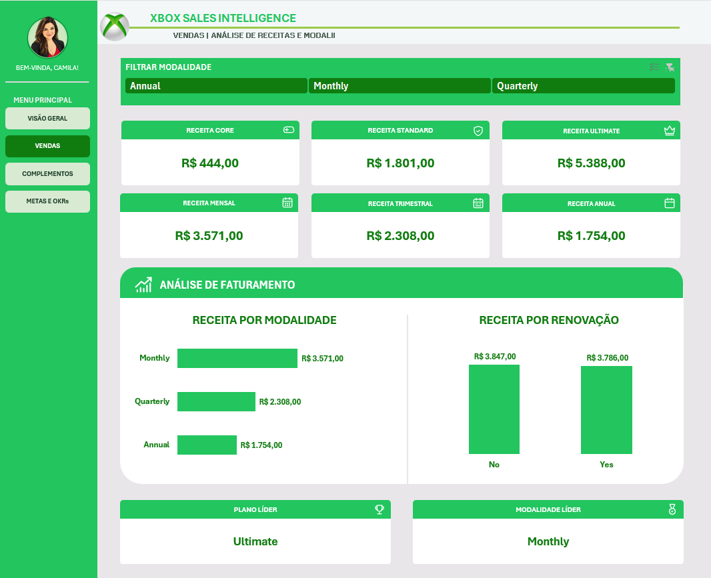
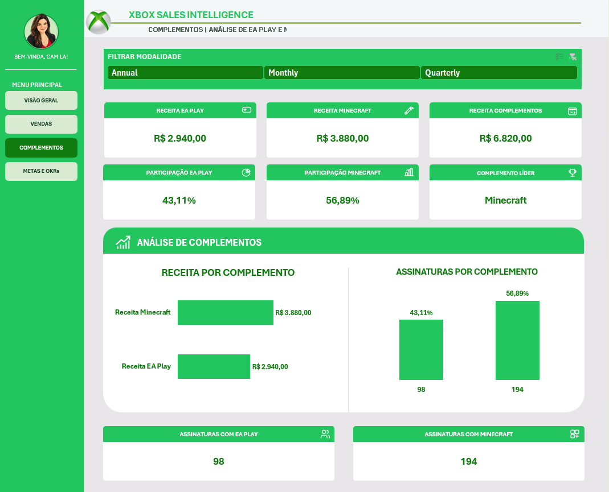
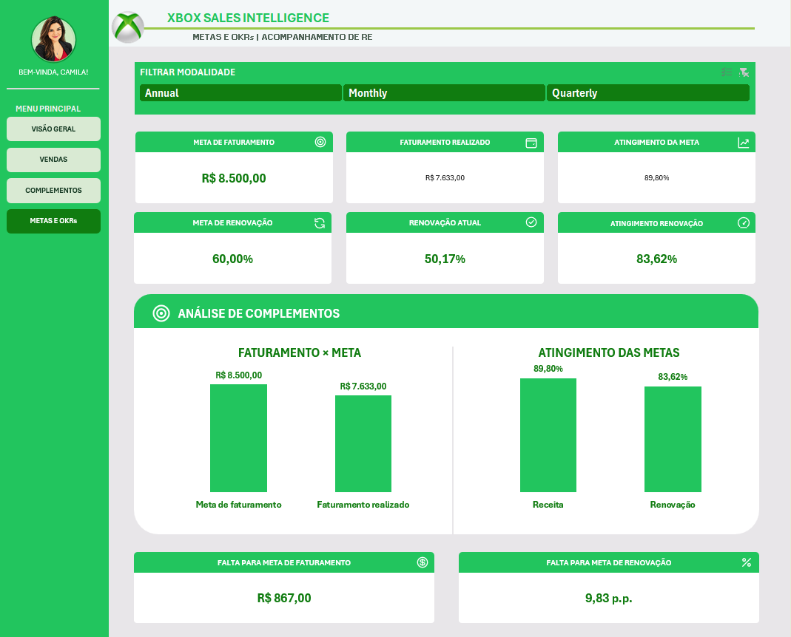
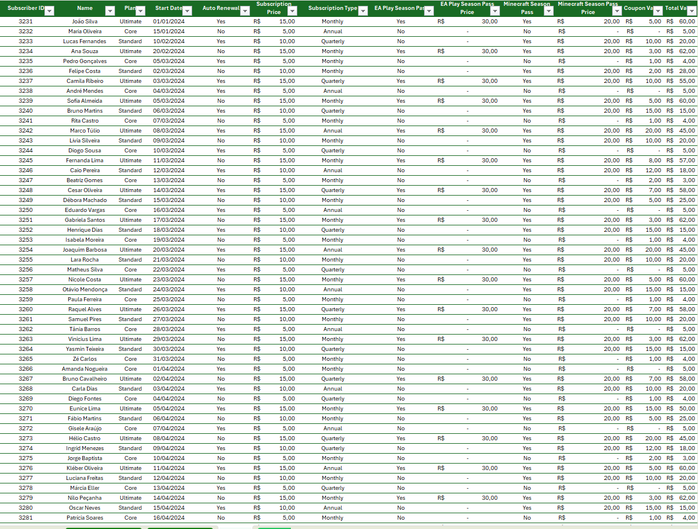
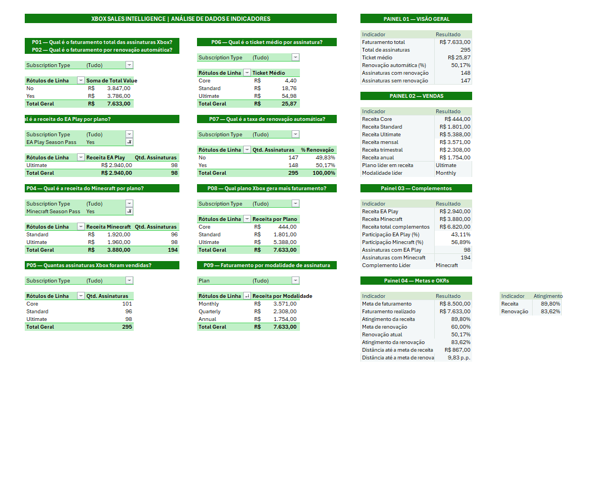

# Xbox Sales Intelligence

**Dashboard de análise de assinaturas, faturamento e metas em Microsoft Excel.**

O Xbox Sales Intelligence reúne quatro painéis para acompanhar o desempenho de uma base demonstrativa de assinaturas Xbox. A solução combina tabelas dinâmicas, segmentações de dados e indicadores para comparar planos, modalidades, renovação automática e complementos.

**[Baixar planilha](Dashboard%20Xbox.xlsx)** · **[Visualizar painéis](#demonstração-dos-painéis)** · **[Consultar metodologia](#metodologia)**

> Projeto educacional. Os dados apresentados não representam resultados comerciais oficiais da Xbox.

## Objetivo

Transformar registros de assinaturas em informações para acompanhamento comercial, com uma interface que facilite a leitura dos resultados e a comparação entre diferentes segmentos da base.

## Demonstração dos painéis

| Visão Geral | Vendas |
|:---:|:---:|
|  |  |
| Faturamento, assinaturas, ticket médio e renovação automática. | Receita por plano, modalidade e configuração de renovação. |

| Complementos | Metas e OKRs |
|:---:|:---:|
|  |  |
| Receitas e participação de EA Play e Minecraft. | Atingimento das metas e distância até os objetivos. |

## Perguntas de negócio

- Qual é o faturamento total e o ticket médio por assinatura?
- Quais planos concentram receita e volume de assinaturas?
- Como a receita se distribui entre as modalidades mensal, trimestral e anual?
- Qual é a proporção de assinaturas com renovação automática?
- Qual é a participação de EA Play e Minecraft na receita dos complementos?
- Quanto falta para atingir as metas de faturamento e renovação automática?

## Indicadores principais

Resultados consolidados da base, sem filtros:

| Indicador | Resultado |
|:---|---:|
| Faturamento total | **R$ 7.633,00** |
| Assinaturas registradas | **295** |
| Ticket médio | **R$ 25,87** |
| Renovação automática | **50,17%** |
| Receita de EA Play, antes dos cupons | **R$ 2.940,00** |
| Receita de Minecraft, antes dos cupons | **R$ 3.880,00** |
| Atingimento da meta de faturamento | **89,80%** |
| Atingimento da meta de renovação automática | **83,62%** |

> O faturamento total já inclui os complementos e desconta os cupons. As receitas de EA Play e Minecraft não devem ser somadas novamente ao total.

## Destaques da análise

- **Ultimate** lidera o faturamento por plano, com **R$ 5.388,00**.
- **Monthly** apresenta a maior receita entre as modalidades, com **R$ 3.571,00**.
- **Minecraft** representa **56,89%** da receita dos complementos antes dos cupons.
- Faltam **R$ 867,00** para a meta de faturamento de R$ 8.500,00.
- A proporção de renovação automática está **9,83 pontos percentuais** abaixo da meta de 60%.

## Metodologia

A pasta de trabalho separa dados, processamento e apresentação:

| Camada | Abas | Finalidade |
|:---|:---|:---|
| **Dados** | BASES | Registros de assinaturas, planos, modalidades, complementos e cupons. |
| **Processamento** | CÁLCULOS | Tabelas dinâmicas, consolidações e fórmulas dos indicadores. |
| **Apresentação** | VISÃO GERAL, VENDAS, COMPLEMENTOS e METAS E OKRs | Exploração dos resultados nos quatro painéis. |

### Regras dos indicadores

| Indicador | Definição |
|:---|:---|
| **Faturamento total** | Soma de `Total Value`: preço da assinatura + preços dos complementos − cupom. |
| **Assinaturas registradas** | Contagem dos registros da base. |
| **Ticket médio** | Faturamento total ÷ quantidade de assinaturas. |
| **Renovação automática** | Registros com `Auto Renewal = Yes` ÷ total de assinaturas. |
| **Participação dos complementos** | Receita de cada complemento ÷ receita conjunta dos complementos. |
| **Atingimento das metas** | Resultado realizado ÷ meta de referência. |

### Cuidados na interpretação

- A **renovação automática** representa a configuração registrada na base, não a ocorrência de uma renovação concluída.
- Uma assinatura pode incluir **os dois complementos**; suas quantidades não correspondem a grupos exclusivos.
- Como os cupons não são distribuídos entre produtos, as receitas individuais dos complementos são apresentadas **antes dos descontos**.

### Estrutura de apoio

| BASES | CÁLCULOS |
|:---:|:---:|
|  |  |
| Dados de origem das assinaturas. | Consolidações e indicadores dos painéis. |

## Tecnologias e recursos

| Recurso | Aplicação |
|:---|:---|
| **Microsoft Excel** | Ambiente de análise e apresentação. |
| **Tabelas dinâmicas** | Consolidação dos dados por plano, modalidade e renovação. |
| **Segmentações de dados** | Filtros por Annual, Monthly e Quarterly. |
| **Fórmulas e referências entre abas** | Alimentação dos indicadores. |
| **Gráficos de barras e colunas** | Comparação de receitas e quantidades. |
| **Formas, ícones e formatação personalizada** | Composição visual dos painéis. |
| **Hiperlinks internos** | Navegação pelo **menu lateral**. |

## Como utilizar

1. **[Baixe o arquivo Excel](Dashboard%20Xbox.xlsx)**.
2. Abra no **Microsoft Excel para desktop**.
3. Comece pela aba **VISÃO GERAL**.
4. Utilize **FILTRAR MODALIDADE** para explorar os resultados.
5. Navegue entre os painéis pelo **menu lateral**.
6. Consulte **BASES** e **CÁLCULOS** para acompanhar a origem dos indicadores.

> **Observação de uso:** foi relatado que os cartões podem abrir zerados e exibir os valores após uma seleção no filtro. A causa desse comportamento ainda está em investigação.

## Arquivos do repositório

| Arquivo ou pasta | Conteúdo |
|:---|:---|
| [Dashboard Xbox.xlsx](Dashboard%20Xbox.xlsx) | Pasta de trabalho com dados, cálculos e painéis. |
| README.md | Documentação do projeto. |
| [images/](images/) | Capturas dos quatro dashboards e das duas abas de apoio. |

## Desenvolvimento e créditos

**Desenvolvimento e personalização:** Camila Ribeiro · [GitHub](https://github.com/camisarp) · [LinkedIn](https://www.linkedin.com/in/camila-ribeiro-pinto/)

**Contexto educacional:** Santander Bootcamp Excel com Inteligência Artificial — [DIO](https://www.dio.me/).

Projeto desenvolvido utilizando exclusivamente a **base de dados fornecida no curso**, com quatro painéis, indicadores e identidade visual personalizada.
